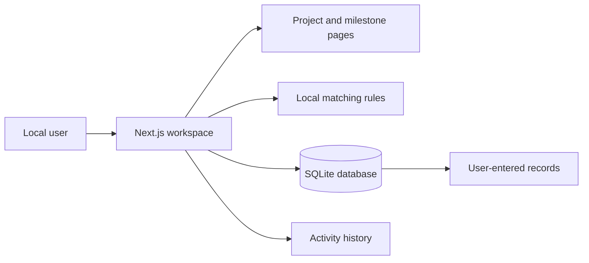

# HACKPRENEUR

A local project-continuation workspace for organizing project profiles, milestones, readiness reviews, mentor records, feedback, and progress after demo day.

## Local workspace

The application runs on your machine and stores records in a local SQLite database at `data/hackpreneur.db`. The database starts empty. The application does not preload example projects, placeholder people, or sample activity.

### Requirements

- Node.js 20.9 or later
- npm

### Start

```bash
npm install
npm run dev
```

The dev and start commands create/synchronize the local database schema before launching, so a fresh database has its tables before any page queries run. You can also run `npm run db:push` manually after schema changes. Open <http://localhost:3000>, then create a project and enter your own information. The project list, directory, milestones, and insights populate from records saved in this database.

### Checks

```bash
npm test
npm run lint
npm run build
```

`npm run db:push` synchronizes the local SQLite schema. There is no seed command; no dummy records are generated. If upgrading from an earlier seeded local build, stop the app and run `npm run db:clear -- --confirm`, then `npm run db:push` to remove that old database and initialize an empty one. This permanently deletes every record in the selected local database; back up any records you want to keep.

## What is included

- Project profiles with team, summary, problem statement, domain, technologies, links, needs, and local visibility settings
- Readiness assessment with next-step recommendations
- Milestone tracking, completion status, and workspace review status
- Mentor and organization profiles that you enter yourself
- Explainable matching based on exact expertise/need tags, domain overlap, and availability
- Structured feedback and conversion of a feedback next step into a milestone
- Workspace insights that count actual saved records
- Local activity history for profile, visibility, matching, and review changes
- Responsive layout with keyboard focus states

## Matching rules

The rules are implemented in `src/matching/score.ts` and are also available from the Matching page:

1. A project must be enabled for local matching.
2. A mentor profile must be marked available for matching.
3. +3 for each exact, case-insensitive project need / mentor expertise match.
4. +1 for each shared domain.
5. +1 when the profile is available for matching.
6. At least one need or domain match is required; availability alone is not enough.

Match suggestions are calculated from the records in this workspace. Saving a match records that choice locally; it does not contact a person or organization.

## Data and privacy

- The SQLite database stays on this machine unless you choose to copy it elsewhere.
- No accounts, email, SMS, or external introductions are configured.
- The project visibility and local matching controls determine whether a project participates in local suggestions.
- Contact details are not requested by the mentor profile form or shown in match results.
- “Verified” records a review made in this workspace. It is not an external audit or certification.
- Use real information only when you have the appropriate permission to store it on this machine.

## Architecture




## Project notes

- Technical choices: [`docs/DECISIONS.md`](docs/DECISIONS.md)
- Current build status: [`docs/PROGRESS.md`](docs/PROGRESS.md)
- Walkthrough: [`docs/LOCAL_WORKFLOW.md`](docs/LOCAL_WORKFLOW.md)

HACKPRENEUR is designed as a local workspace. This repository does not configure cloud deployment or external services.
