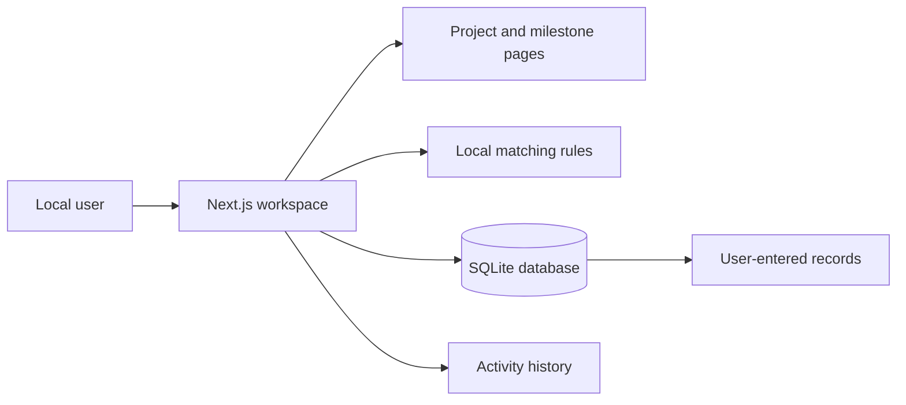
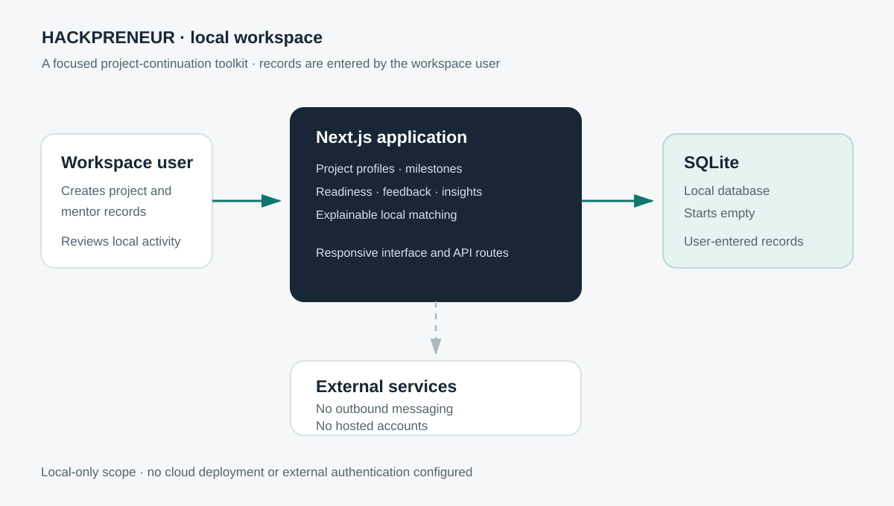

# HACKPRENEUR

A local project-continuation workspace for organizing project profiles, milestones, readiness reviews, mentor records, feedback, and progress after demo day.

## Local workspace

The application runs on your machine and stores records in a local SQLite database at `data/hackpreneur.db`. The database starts empty; demo records are opt-in and never loaded automatically. You can add a clearly synthetic dataset for testing with `npm run db:seed`.

### Requirements

- Node.js 20.9 or later
- npm

### Start

```bash
npm install
npm run dev
```

The dev and start commands create/synchronize the local database schema before launching, so a fresh database has its tables before any page queries run. You can also run `npm run db:push` manually after schema changes. Open <http://localhost:3000>, then create a project and enter your own information. The project list, directory, milestones, and insights populate from records saved in this database.

To explore the interface with sample records instead, run `npm run db:seed` before starting the app. This adds 12 synthetic projects, 16 synthetic mentor profiles, milestones, feedback, readiness checks, consent states, explainable matches, and a short sample activity history. All demo records are marked with `DEMO` names and stable `demo-` IDs. The command is safe to rerun and does not overwrite or delete other records. Use a fresh database if you want to keep demo records separate from your own workspace; for example, `DB_FILE_NAME=./data/demo.hackpreneur.db npm run db:seed` creates a separate demo database.

### Checks

```bash
npm test
npm run lint
npm run build
```

`npm run db:push` synchronizes the local SQLite schema. `npm run db:seed` adds the opt-in synthetic demo dataset without clearing the database. If you want to remove demo records, stop the app and run `npm run db:clear -- --confirm`, then `npm run db:push` to initialize an empty database. This permanently deletes every record in the selected local database; back up any records you want to keep.

## What is included

- Project profiles with team, summary, problem statement, domain, technologies, links, needs, and local visibility settings
- Readiness assessment with next-step recommendations
- Milestone tracking, completion status, and workspace review status
- Mentor and organization profiles that you enter yourself
- Explainable matching based on exact expertise/need tags, domain overlap, and availability
- Structured feedback and conversion of a feedback next step into a milestone
- Workspace insights that count actual saved records
- Local activity history for profile, visibility, matching, and review changes
- Responsive layout with keyboard focus states

## Matching rules

The rules are implemented in `src/matching/score.ts` and are also available from the Matching page:

1. A project must be enabled for local matching.
2. A mentor profile must be marked available for matching.
3. +3 for each exact, case-insensitive project need / mentor expertise match.
4. +1 for each shared domain.
5. +1 when the profile is available for matching.
6. At least one need or domain match is required; availability alone is not enough.

Match suggestions are calculated from the records in this workspace. Saving a match records that choice locally; it does not contact a person or organization.

## Data and privacy

- The SQLite database stays on this machine unless you choose to copy it elsewhere.
- No accounts, email, SMS, or external introductions are configured.
- The project visibility and local matching controls determine whether a project participates in local suggestions.
- Contact details are not requested by the mentor profile form or shown in match results.
- “Verified” records a review made in this workspace. It is not an external audit or certification.
- Use real information only when you have the appropriate permission to store it on this machine.

## Deploying

The application is a Next.js server app backed by a SQLite file, so it needs a host that runs Node server code — **Vercel** works. Static-only hosts and Cloudflare Pages/Workers do not: `better-sqlite3` is a native addon and cannot be loaded in the Workers runtime.

On Vercel, leave the build command as the default `npm run build`. There is nothing else to configure, and no environment variables are required.

```
Framework preset:  Next.js
Build command:     npm run build
```

Do **not** use `npm run db:seed && npm run build`. Seeding at build time writes `data/hackpreneur.db` inside the build container, and that directory is not part of the deployment — `data/*.db` is gitignored and is absent from the traced server bundle, so the file is discarded the moment the build finishes.

### How the database works when deployed

A serverless host has a read-only filesystem apart from `/tmp`, and it never runs `predev` / `prestart`, so neither the schema push nor a seeded database reaches the running code. `src/db/index.ts` handles both at import time:

1. It opens `./data/hackpreneur.db` when that path is writable — the local case.
2. Otherwise it falls back to `hackpreneur.db` in the OS temp directory, and seeds the synthetic demo dataset there so a deployed instance is not an empty workspace.
3. It applies the compiled DDL in `src/db/schema-sql.ts` (generated from `src/db/schema.ts` by `npm run db:schema-sql`), because `drizzle-kit` is a devDependency and is not present at runtime.

Set `DB_FILE_NAME` to pin an exact path. That is an explicit instruction, so it is used or it fails loudly with the reason — it never silently relocates. `SEED_DEMO_DATA=true` seeds a local database on first boot too.

### The limitation you are accepting

`/tmp` on a serverless host is **per-instance and ephemeral**. Writes succeed, but each cold start and each concurrent instance gets its own copy, and everything is lost when the instance is recycled. A Vercel deployment is therefore a demonstration, not a shared workspace. Real persistence needs a networked database — swapping the driver to libSQL/Turso keeps this codebase working on both Vercel and Cloudflare Pages.

## Architecture





## Project notes

- Technical choices: [`docs/DECISIONS.md`](docs/DECISIONS.md)
- Current build status: [`docs/PROGRESS.md`](docs/PROGRESS.md)
- Walkthrough: [`docs/LOCAL_WORKFLOW.md`](docs/LOCAL_WORKFLOW.md)

HACKPRENEUR is designed as a local workspace. It deploys to Vercel for demonstration, with the ephemeral-storage limitation described above; it configures no external services.
