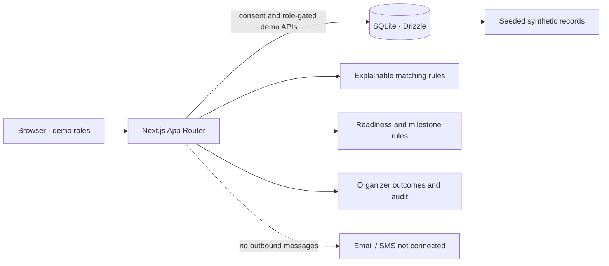

# HACKPRENEUR

**Don't let your hackathon project die.** HACKPRENEUR helps a team take the next step after demo day: create a project profile, check readiness, track milestones, get structured feedback, and explore transparent suggested matches. Organizers get a view of continuation while self-reported and verified outcomes stay separate.

> **Prototype with synthetic data.** This is a local demo, not a production service. There is no real sign-in, no email/SMS delivery, and no guaranteed introductions or funding. Demo roles and sample records are fictional.

## For the WhyCode4U Hackathon 2026

Track 3, Problem 2 · Team Visonaris (leader: Om).

### What works now

- Responsive landing page plus Projects, Mentors, Milestones, Dashboard, Directory, Readiness, Matching, and Audit pages.
- Demo role switcher: Team, Mentor, Organizer.
- Team-created project profiles with visibility control and explicit consent before mentor profile sharing.
- Private and unconsented projects are excluded from mentor views and matching. Contact details are not surfaced.
- Explainable rule-based matching: +3 per exact need/expertise tag, +1 per shared domain, +1 for mentors accepting suggestions. A “Why matched” explanation is shown; suggestions are not promises.
- Eight-item readiness self-check and rule-based milestone recommendations.
- Structured mentor/organizer feedback that a team can turn into a milestone.
- Organizer overview distinguishes self-reported from verified completed milestones. Verification requires a completed milestone.
- In-app overdue reminder panel labelled “Simulated: no message is sent.” Organizer-only audit history for consent, visibility, match choice, and verification.
- All seeded project, mentor, team, feedback, and contact-like identities are synthetic. Email examples use `example.com`.

### Assumptions and limitations

- Designed for college hackathons in India; English UI first.
- Mentors and communities are organizer-managed; there is no open signup.
- Matching and readiness are simple, visible rules (no AI API).
- A mentor/organizer click is the prototype's verification step, not third-party proof.
- A project counts as “continued” when at least one milestone is complete or a verified update occurred within 30 days.
- Demo role cookies are **not authentication**. API role checks are for a single-user demo only and are not suitable for real users or production deployment.
- Local SQLite is stored in ignored `data/hackpreneur.db`. This project is intentionally local-only for now. A future public deployment would need a hosted persistent database, production authentication/authorization, and an updated privacy/security review.
- Reminders are generated in the interface only; nothing is sent. No contact details are shared and no introduction is actually arranged.
- No real personal information should be entered.

## Run locally

Requirements: Node.js 20.9+ (tested with Node.js 22.22.3) and npm.

```bash
npm install
npm run db:reset
npm run dev
```

Open <http://localhost:3000>. On first visit the role defaults to Team. Use the selector in the top bar to switch roles. The sample database can be reset at any time with `npm run db:reset`; it is safe to rerun and only restores fictional seed data.

Useful commands:

```bash
npm run lint
npm run build
npm run db:push
npm run db:seed
```

Optional database location override: set `DB_FILE_NAME` to a SQLite file path. The local DB is ignored by Git.

## Technology choices

- Next.js 16.4.3 App Router, React 19.3.0, TypeScript
- Tailwind CSS 4.3.3 plus authored responsive CSS
- Drizzle ORM 0.45.4 + SQLite + better-sqlite3 13.0.3 for local demo storage
- ESLint 9, Node.js 22.22.3 in the build environment
- Hosting: local development server only for this prototype. Vercel was researched as a possible future option, but is not configured or part of the current build.

## How matching works

See the public **How matching works** page (`/matching`) and the central implementation in `src/matching/score.ts`.

1. No suggestions are computed unless the team granted profile-sharing consent.
2. Mentors who are not accepting suggested introductions are excluded.
3. +3 for each exact case-insensitive project need / mentor expertise-tag match.
4. +1 for a shared project / mentor domain.
5. +1 when the mentor is accepting suggested introductions.
6. Reasons and the point breakdown are displayed. The system does not promise funding or an introduction.

## Architecture




The SVG diagram is also available at [`docs/architecture.svg`](docs/architecture.svg).

## Privacy and safety

- Teams control project visibility and must grant explicit profile-sharing consent before their information can be shown to mentors.
- Private projects never appear in the mentor listing or matching.
- Contact details are not included in mentor screens. No real contact data is seeded.
- Self-reported and verified milestones have distinct labels and separate dashboard counts.
- Verification is a human demo action, not automatic proof.
- The matching and reminders pages explain limitations and the absence of guarantees or outbound messages.

## Demo walkthrough

A 3-minute suggested path is in [`docs/DEMO_SCRIPT.md`](docs/DEMO_SCRIPT.md). Screenshot checklist is in the same file.

## Decisions and progress

- Research, stack/version findings, and hosting caveats: [`docs/DECISIONS.md`](docs/DECISIONS.md).
- Phase-by-phase status: [`docs/PROGRESS.md`](docs/PROGRESS.md).

## Future work before real deployment

Use a durable hosted database, real authentication and server-enforced team ownership, production secret management, security/privacy review, user testing, and a real deployment smoke test. Add real messaging only with explicit opt-in and a reliable delivery/audit design. These items are intentionally not simulated as working production functionality here.
